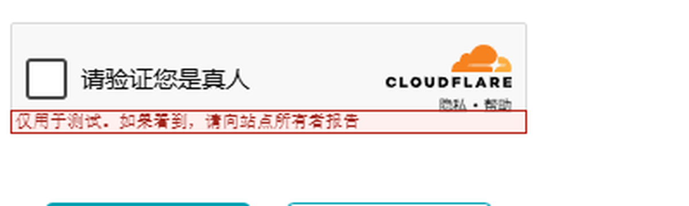
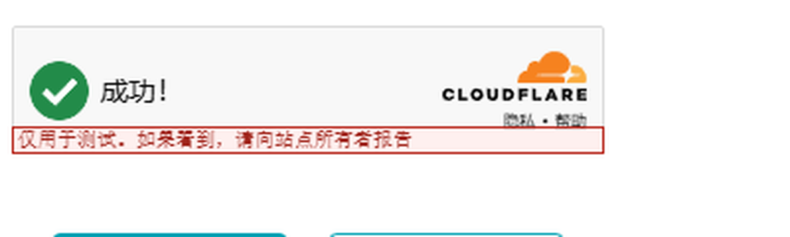

<div align="center">

# mousectl

**Real, humanized mouse input for DeepSeek Harness — Win32 `SendInput`, not synthetic DOM events.**

**为 DeepSeek Harness 提供的真实、拟人化鼠标输入 —— 走 Win32 `SendInput`，而不是合成 DOM 事件。**

[](#requirements--环境要求)
[](#requirements--环境要求)
[](#requirements--环境要求)
[](LICENSE)

</div>

---

## Why / 为什么

| | `element.click()` | **mousectl** |
|---|---|---|
| `event.isTrusted` | `false` ❌ | **`true`** ✅ |
| `screenX` / `screenY` | often `0` or faked ❌ | **real coordinates** ✅ |
| hover → mousedown → click order | missing ❌ | **browser-native** ✅ |
| pointer path | none (teleport) ❌ | **Bézier curve + easing** ✅ |
| landing point | always dead center ❌ | **randomized in-element** ✅ |

`isTrusted === false` is the first signal anti-automation scripts check.
Clicking through the OS input layer makes the browser see genuine trusted
events, which is what produces `isTrusted === true`.

`isTrusted === false` 是反自动化脚本最先检查的信号。
经由操作系统输入层点击，浏览器看到的是真实的可信事件，
因此 `event.isTrusted` 为 `true`。

> **Honest scope / 诚实的范围** — This raises "looks human", **not** "invisible".
> It does not defeat TLS fingerprinting, canvas or WebGL fingerprinting.
> See [Generality & limits / 通用性与限制](#generality--limits--通用性与限制).

> **Honest scope / 诚实的范围** —— 它提升的是"看起来像真人"，**不是"隐形"**。
> 它无法绕过 TLS 指纹、canvas / WebGL 指纹。
> 见 [通用性与限制](#generality--limits--通用性与限制)。

---

## Install / 安装

### As a DeepSeek Harness plugin / 作为 DSH 插件

A third-party plugin must be a **bundle**: a package whose root declares
`dsh.bundle.patch`. Without it DSH refuses the package with `not-a-bundle`.

第三方插件必须是 **bundle**：包根目录要声明 `dsh.bundle.patch`。
否则 DSH 会以 `not-a-bundle` 拒绝加载。

```bash
# Install into your DSH profile / 安装到 DSH profile
dsh plugin install /path/to/this/repo
# or via the agent / 或让 agent 调用 plugin_manager 工具
```

Then **fully restart DSH** — quitting the window is usually not enough;
make sure the tray process is gone too.

然后**完全重启 DSH** —— 只关窗口通常不够，要确认托盘进程也退出了。

### Standalone / 独立使用

The engine is a plain Python script with **zero third-party dependencies**:

引擎是纯 Python 脚本，**零第三方依赖**：

```bash
python python/winmouse.py pos                    # cursor position / 光标位置
python python/winmouse.py screen                 # virtual screen / 虚拟屏幕
python python/winmouse.py windows --filter Edge  # find a window / 找窗口
python python/winmouse.py wrect --window Edge    # window rectangle / 窗口矩形
python python/winmouse.py click --x 600 --y 400  # click / 点击
python python/winmouse.py click --x 600 --y 400 --dry-run   # preview only / 只预演
```

---

## Tools / 提供的工具

| Tool | Purpose / 用途 |
|---|---|
| `mouse_click` | Click at `x`/`y`, or inside a window found by title. <br>按 `x`/`y` 点击，或点击按标题找到的窗口内部。 |
| `mouse_move` | Move the cursor with a humanized path. <br>沿拟人化轨迹移动光标。 |
| `mouse_scroll` | Wheel scroll; positive is up. <br>滚轮滚动，正数向上。 |
| `mouse_windows` | List visible windows with exact screen rectangles. <br>列出可见窗口及其精确屏幕矩形。 |

---

## Requirements / 环境要求

- **Windows.** Uses `SendInput` via `ctypes`.
- **Python 3.8+.** Standard library only — no `pip install` needed for clicking.
  (`comtypes` is optional, only for locating elements by accessible name.)
- **A visible, interactive desktop session.** System-level input cannot be
  delivered to a locked or headless session.

<!-- -->

- **Windows。** 通过 `ctypes` 调用 `SendInput`。
- **Python 3.8+。** 仅用标准库 —— 点击功能无需 `pip install`。
  （`comtypes` 是可选的，仅在按无障碍名称定位控件时需要。）
- **需要可见的交互式桌面会话。** 锁屏或无头环境下系统级输入无法投递。

---

## Verification / 验证

Everything here was measured, not assumed. Reproduce with:

这里的一切都经过实测，不是推测。复现方式：

```bash
python tools/selftest.py        # 16 checks, no network / 16 项检查，无需联网
python tools/browsercheck.py    # real browser, reads back isTrusted / 真实浏览器
```

**Real-browser result / 真实浏览器实测结果:**

```json
{ "isTrusted": true, "screenX": 342, "screenY": 436,
  "clientX": 270, "clientY": 295, "detail": 1, "pointerType": "mouse",
  "moves": 34, "enters": 2, "down": 1 }
```

Control group — the same button clicked with JS `element.click()`:

对照组 —— 同一按钮用 JS `element.click()` 触发：

```json
{ "isTrusted": false }
```

### Cloudflare Turnstile / Cloudflare Turnstile 实测

A genuine system-level click **passes** the interactive "click me" checkbox.

真实系统级点击**可以通过**交互式「click me」复选框。

| Before / 点击前 | After / 点击后 |
|---|---|
|  |  |
| ⬜ empty checkbox + `请验证您是真人` | ✅ green tick + `成功!` |

```bash
python tools/turnstile_upright.py --fresh   # upright widget / 正放控件
python tools/turnstile_vision.py  --fresh   # pure-vision localisation / 纯视觉定位
```

**What this does and does not show / 这说明了什么、没说明什么**

- ✅ It shows Turnstile's interactive checkbox **accepts** system-level input.
- ❌ It does **not** show non-interactive JS-only challenges can be passed,
  nor that harder protection tiers will be, nor anything about long-term
  success rates.

<!-- -->

- ✅ 说明 Turnstile 的交互式复选框**接受**系统级输入。
- ❌ **不**说明非交互式纯 JS 判定能过，**不**说明更强防护档位能过，
  也**不**说明长期成功率。

---

## Generality & limits / 通用性与限制

> This section is deliberately blunt. An earlier version of this project
> over-claimed, and the measurements did not support it.
>
> 这一节故意写得很直白。本项目早期版本有过夸大，而实测数据并不支持。

The pure-vision locator (`tools/locator.py`) works by finding the widget
**panel** (largest bright low-saturation component) and then the checkbox
**inside** it. Two claims I originally made were **wrong**:

纯视觉定位器（`tools/locator.py`）的思路是：先找控件**面板**（最大的低饱和亮连通域），
再找面板**内部**的复选框。我最初的两个说法是**错的**：

| Claim I made / 我当时的说法 | Measured reality / 实测 |
|---|---|
| "27× separation, unambiguous" | ❌ Artifact of manually cropping to the browser area. Uncropped, the page background (797 231 px) beats the panel (32 183 px). <br>❌ 手工裁剪到浏览器区域造成的假象。不裁剪时整页背景(797 231px)远大于面板(32 183px)。 |
| "Exactly 1 candidate in the panel" | ❌ Uncropped it is **17 candidates**. <br>❌ 不裁剪时是 **17 个候选**。 |
| "2 px accuracy" | ✅ True, but **only after manual cropping**. <br>✅ 事实，但**仅在手工裁剪之后**。 |

**Current honest status / 当前诚实的定位:**

> A **Turnstile-specific locator** that needs a known search region —
> **not** a general-purpose visual clicker.

> 一个**针对 Turnstile 的特化定位器**，需要已知搜索区域 ——
> **不是**通用视觉点击器。

**Known limitations / 已知限制**

- The physical cursor **is** moved. Do not use the mouse while it runs.
  <br>会**真实移动物理光标**，运行期间请勿手动操作鼠标。
- The target window must be foregrounded. `SendInput` reports success even when
  the click lands on a covering window — **silently**.
  <br>目标窗口需在前台。即使点击落到遮挡窗口上，`SendInput` 也返回成功 —— **且无任何报错**。
- If DSH and the target run at different integrity levels, UIPI may block input.
  <br>若 DSH 与目标程序权限不一致，UIPI 可能拦截输入。
- Browser window coordinates ≠ page coordinates (borders + chrome ≈ 12 px / 81 px
  on the test machine).
  <br>窗口坐标 ≠ 页面坐标（测试机上边框/标签栏约差 12px / 81px）。

---

## Layout / 目录结构

```
.
├── lib/index.js            # DSH plugin: registers the 4 tools / 注册 4 个工具
├── python/winmouse.py      # Win32 SendInput engine / Win32 输入引擎
├── cordis.patch.yml        # bundle patch (must use `- insert:`) / bundle 声明
├── tools/
│   ├── vision.py           # hand-rolled Otsu + connected components / 手写视觉原语
│   ├── locator.py          # two-stage panel→checkbox locator / 两阶段定位器
│   ├── selftest.py         # 16 offline checks / 16 项离线检查
│   ├── browsercheck.py     # real-browser isTrusted test / 真实浏览器验证
│   ├── turnstile_*.py      # Turnstile experiments / Turnstile 实验
│   └── project3d.py        # CSS 3D projection (see docs) / CSS 3D 投影
└── docs/                   # detailed Chinese write-ups / 详细中文记录
```

---

## Lessons learned / 踩过的坑

These were all found by **running** the code, not by reading it.

这些都是**跑起来**才发现的，不是看代码能看出来的。

1. **Silent click misses.** `SendInput` returns `sent=1, lasterr=0` but the click
   lands on whatever is on top. Minimized windows are refused explicitly.
   <br>**点击静默落空。** `SendInput` 返回成功，但点击落到最上层窗口。已显式拒绝最小化窗口。
2. **Bundle patches need `- insert:`.** A bare entry list is read as an
   *override* of an existing row → `rows: []` and the plugin never loads,
   **with no error**.
   <br>**bundle patch 必须用 `- insert:`。** 裸条目列表会被当成"覆盖已存在的行"，导致 `rows: []` 且插件永不加载，**且不报错**。
3. **`required` differs by location.** In a flat `parameters` map,
   `required: true` goes on the property; `output.schema` is compiled with
   `allowRequired: false`, so `required` is **forbidden anywhere** there.
   <br>**`required` 在两个地方规则相反。** `parameters` 是扁平表，写在属性里；`output.schema` 以 `allowRequired: false` 编译，**任何位置都不能出现**。
4. **`--json` must be passed on every path.** Real clicks printed human text,
   so the plugin's JSON parse failed on a success.
   <br>**`--json` 每条路径都要传。** 真实点击返回人类文本，导致插件在成功时解析失败。
5. **Chromium titles contain a zero-width space** (`Microsoft\u200b Edge`), so
   naive substring matching fails. Titles are normalized.
   <br>**Chromium 标题含零宽空格**，朴素子串匹配会失配。已做归一化。
6. **Chinese Windows consoles are GBK**, so printing a zero-width space raises
   `UnicodeEncodeError` and aborts the command. Output is ASCII-escaped.
   <br>**中文控制台是 GBK**，打印零宽字符会抛 `UnicodeEncodeError` 并中断命令。输出做了 ASCII 转义。
7. **`ctypes.WinError` is a function, not an exception class** — it cannot go
   in an `except` clause.
   <br>**`ctypes.WinError` 是函数不是异常类**，不能写在 `except` 里。

---

## License

MIT — see [LICENSE](LICENSE).

## Acknowledgements / 致谢

Built for [DeepSeek Harness](https://github.com/deepseek-ai/deepseek-harness).

为 [DeepSeek Harness](https://github.com/deepseek-ai/deepseek-harness) 而做。
